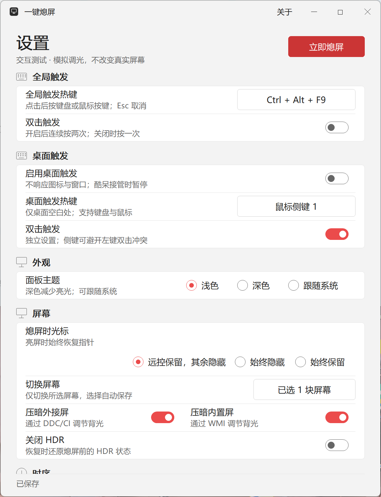
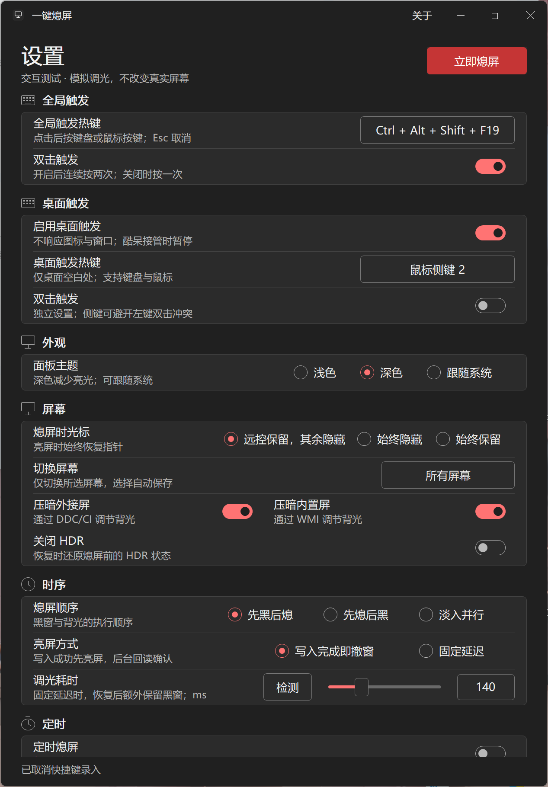

# screen-toggle

**用 Rust 和 Win32 编写的一键熄屏工具：单个 EXE、低内存占用、多屏并行调光、快速恢复桌面。**

通过全屏黑色覆盖窗与显示器亮度控制，使屏幕变暗，同时让系统、下载任务和远程桌面继续运行。适合需要暂时隐藏本机画面、又希望电脑继续工作的场景。

[下载 v0.4.0](https://github.com/shiranzby/screen-toggle/releases/tag/v0.4.0) · [更新记录](CHANGELOG.md) · [代码架构](docs/ARCHITECTURE.md) · [验证与性能口径](docs/VALIDATION.md) · [Twinkle Tray 对比与路线图](docs/TWINKLE_TRAY_COMPARISON.md)

v0.4.0 增加两套独立的全局／桌面键盘或鼠标触发、单双击开关与逐屏选择，修复 HDR 和 WMI 相关恢复问题。黑屏后同一桌面手势可亮屏；内外屏调光开关合并为一行。桌面触发默认关闭，亮屏时排除图标、其它窗口和酷呆接管区域。详见[恢复说明](docs/RECOVERY_AND_MOUSE.md)与[选屏说明](docs/DISPLAY_SELECTION.md)。

## 设置面板

支持浅色、深色和跟随系统三种主题。以下为 v0.4.0 隔离测试模式下的真实面板截图，热键与开关为示例配置，截图过程不修改真实亮度。

<table>
  <tr><th width="50%">浅色</th><th width="50%">深色</th></tr>
  <tr>
    <td></td>
    <td></td>
  </tr>
</table>

## 特点

### 原生、轻量

- **Rust + windows-rs + Win32 API**，默认采用 GDI/GDI+ 绘制界面。
- v0.4.0 发布文件约 **741 KiB**，下载一个 EXE 即可使用。
- 运行时无需安装 Python、.NET、Qt、Electron、WebView 或 XAML 框架。
- v0.4.0 托盘冷启动实测私有提交约 **2.39 MiB**，工作集约 **12.91 MiB**。这是默认输入配置下的托盘样本；启用监听、显示设置或操作硬件后的占用可能更高。

以上来自本发布构建的单机采样，没有主动裁剪工作集。私有提交和工作集是不同指标，也未对 Twinkle Tray 做同环境资源测量。[查看测量条件](docs/VALIDATION.md#资源占用)

### 快速切换，多屏并行

- “先黑后熄”先呈现黑窗，再执行背光调节，减少等待时仍看到桌面的时间。
- 黑窗与光标策略在同一个 UI 操作中切换；恢复时也一起提交。
- 外接屏通过 **DDC/CI** 调光，内置屏通过 **WMI** 调光；不同设备并行，同一设备的请求保持顺序。
- 默认亮屏方式为“写入完成即撤窗”：全部目标写入成功后恢复桌面和光标，后台继续精确回读。
- v0.4.0 的 Type-C 两轮正常亮屏测试，引擎到 UI 恢复确认约 **60–73 ms**，完整请求约 **106–119 ms**；硬件批次含精确回读约 **104–117 ms**。这是单屏两轮样本，不是面板物理响应或所有多屏组合的保证。

速度受显示器固件、DDC/CI、驱动和 WMI 实现影响。[查看计时边界](docs/VALIDATION.md#切换延迟)

### 恢复保护

- 硬件改动前持久保存逐设备原始状态，恢复按设备身份匹配。
- 保留亮度写入后的精确回读，确认成功才清除相应恢复记录。
- 快速反向切换使用代际取消，旧任务结束后再处理后续操作。
- 退出、部分失败和异常重启均有恢复路径；失败项继续保留记录。
- 可选熄屏时关闭 HDR，并在恢复时还原原有状态。

## 功能一览

| 设置 | 作用 |
| --- | --- |
| 全局热键 | 默认 `Ctrl + Alt + S`；点击录入后可修改，`Esc` 取消 |
| 桌面热键 | 独立启用，可录键盘、左／右／中键与侧键；桌面空白触发，黑屏时在覆盖区亮屏 |
| 双击触发 | 全局与桌面分别设置，开启后连续按两次，关闭后按一次 |
| 面板主题 | 浅色、深色、跟随系统 |
| 熄屏时光标 | 自动判断、始终隐藏、始终保留；亮屏时恢复指针 |
| 外接屏 / 内置屏 | 分别选择是否通过 DDC/CI、WMI 压暗背光 |
| 切换屏幕 | 全部屏幕或指定屏幕，按完整身份保存；断连不自动换目标 |
| 关闭 HDR | 熄屏时关闭，亮屏时恢复原状态 |
| 熄屏顺序 | 先黑后熄、先熄后黑、淡入并行 |
| 亮屏方式 | 写入完成即撤窗，或完整确认后追加固定延迟 |
| 调光耗时 | `0–500 ms`，控制固定延迟模式恢复后保留黑窗的时间；可检测参考值 |
| 定时熄屏 | 每天按指定时间熄屏、亮屏；手动操作后 10 分钟内定时让步 |
| 开机静默启动 | 当前用户登录后驻留托盘；手动双击仍显示设置 |
| 关闭窗口时 | 隐藏到托盘，或恢复屏幕后退出 |

“自动判断”只接受本机正在被控制的桌面会话证据。第三方远控适配尚有未验证边界；需要远控时稳定保留光标，可直接选择“始终保留”。

只切换部分屏幕时保留全局指针，方便使用其余屏幕。通用亮度滑块、校准曲线、应用配置与其它 DDC 功能属于[后续计划](docs/TWINKLE_TRAY_COMPARISON.md)，尚未实现。

## 下载与使用

1. 打开 [Releases](https://github.com/shiranzby/screen-toggle/releases)，下载 `screen-toggle-v0.4.0-windows-x64.exe`。当前提供 Windows x64 版本，面向 Windows 10/11。
2. 双击打开设置页，按需选择内置屏、外接屏、光标和亮屏方式。更改自动保存。
3. 按 `Ctrl + Alt + S` 或点击“立即熄屏”；再次执行即可恢复。也可通过托盘菜单操作。
4. 需要登录后后台运行时，启用“开机静默启动”。关闭面板默认隐藏到托盘。

正常使用无需开发环境。可用下列命令核对下载文件，并与 Release 中的 `.sha256` 文件比较：

```powershell
Get-FileHash .\screen-toggle-v0.4.0-windows-x64.exe -Algorithm SHA256
```

后台启动：

```powershell
.\screen-toggle-v0.4.0-windows-x64.exe --silent
```

已有后台实例时，手动双击会重新显示设置页。

### 配置与恢复记录

默认数据目录为 `%APPDATA%\ScreenOffGuard\`。该目录名称保留用于兼容已有设置：

| 文件 | 内容 |
| --- | --- |
| `settings.json` | 主题、热键、调光策略、定时和启动偏好 |
| `recovery.json` | 尚未完成恢复的设备状态；成功恢复后自动清除 |

需要独立配置时，可指定绝对路径：

```powershell
.\screen-toggle-v0.4.0-windows-x64.exe --data-dir "C:\ScreenToggleProfile"
```

如果恢复失败，先保持显示器连接，再尝试恢复或正常退出。程序下次启动会处理未完成的恢复记录；不要手动删除仍有待恢复设备的 `recovery.json`。

## 工作原理

1. **软件遮挡**：按所选显示器的区域创建黑窗，并应用光标策略。黑窗允许点击穿透，并请求 Windows 将其排除在屏幕捕获之外，便于远程操作；实际捕获结果取决于系统与远控软件的捕获路径。
2. **背光调节**：读取设备原状态，保存恢复记录，再通过 DDC/CI 或 WMI 压暗。多块显示器独立并行执行。
3. **恢复显示**：向设备写回原值。默认在所有写入成功后撤掉黑窗、恢复光标，后台继续回读；只有确认成功才清除恢复记录。

这是软件熄屏和背光调节。电脑会继续工作，显示输出与显示器电源仍然开启；屏幕最低亮度是否全黑取决于硬件。需要系统锁屏或休眠时，应使用 Windows 对应功能。

### “调光耗时”为什么不总能改变亮屏速度？

该值只在“固定延迟”模式中生效：完整恢复确认后，再额外保留黑窗指定毫秒数。默认“写入完成即撤窗”不使用这段延迟，熄屏也不依靠它加速。

“检测”会先压暗再恢复，并保留完整回读；参考值取两阶段较慢的整批确认耗时，上限 500 ms。它用于估计遮挡时间，修改这个数字不会让 DDC/CI 或 WMI 的硬件调用本身更快。

## 源码与目录

```text
screen-toggle/
├─ rust/
│  ├─ Cargo.toml          # Rust 包、依赖与构建选项
│  ├─ Cargo.lock          # 固定依赖版本
│  ├─ build.rs            # Windows manifest 与图标资源
│  ├─ icon.ico            # 应用图标
│  ├─ src/
│  │  ├─ main.rs          # 程序入口
│  │  ├─ app.rs           # 托盘、消息分发、热键与后台任务协调
│  │  ├─ panel.rs         # 设置页布局、绘制与原生控件交互
│  │  ├─ engine.rs        # 熄屏/恢复事务、取消、回读与恢复记录
│  │  ├─ native.rs        # DDC/CI、WMI、HDR 设备后端
│  │  ├─ config.rs        # 配置模型、校验与旧配置兼容
│  │  ├─ storage.rs       # 配置和恢复记录的原子落盘
│  │  ├─ remote.rs        # 远控会话证据与光标自动策略
│  │  ├─ schedule.rs      # 每日定时和手动操作优先策略
│  │  ├─ theme.rs         # 浅色/深色/系统配色
│  │  ├─ about.rs         # 关于窗口
│  │  ├─ desktop_mouse.rs # 输入钩子、桌面命中与黑屏唤醒门禁
│  │  ├─ display_picker.rs # 逐屏选择窗口与分页
│  │  ├─ antialias.rs     # GDI+ 抗锯齿绘制
│  │  ├─ d2d.rs           # 可选 Direct2D 绘制实验
│  │  ├─ win.rs           # 通用 Win32 窗口、字体与字符串辅助
│  │  └─ lib.rs           # 领域逻辑与后端的库入口
│  ├─ tests/              # 恢复失败与屏幕选择集成反例
│  └─ examples/           # 调度与硬件链路诊断程序
├─ checks/                # 构建、UI、资源与硬件验证脚本
│  └─ evidence/           # 当前发布版本的少量验证结果
├─ docs/
│  ├─ images/             # README 使用的真实面板截图
│  ├─ ARCHITECTURE.md     # 模块边界、线程和操作链路
│  ├─ VALIDATION.md       # 测量条件、结果与验证范围
│  └─ TWINKLE_TRAY_COMPARISON.md # 功能、架构与扩展路线
├─ build.bat              # Windows 一键构建入口
├─ start.bat              # 启动本地构建产物
├─ CHANGELOG.md           # 版本变化
├─ VERSION                # 当前发布版本
└─ LICENSE                # MIT License
```

历史 Rust 版本通过各自的 Git 标签查看，不在当前分支重复堆放源码。当前开发代码位于 `rust/`。更多设计说明见 [ARCHITECTURE](docs/ARCHITECTURE.md)。

## 本地构建

准备 Windows 开发环境：

- Rust 稳定版及 `x86_64-pc-windows-msvc` 工具链。
- Visual Studio Build Tools 的“使用 C++ 的桌面开发”、MSVC 链接器与 Windows SDK。
- PowerShell。

在仓库根目录执行：

```powershell
.\build.bat
```

也可直接运行：

```powershell
powershell.exe -NoProfile -ExecutionPolicy Bypass -File .\checks\build_release.ps1
```

脚本依次执行格式检查、全目标全 feature Clippy、单元测试和 release 编译。中间产物放在 `.build/`，最终程序为 `artifacts/sog.exe`；执行 `start.bat` 可启动。内部 Cargo 包名和本地产物名沿用 `sog`，GitHub 发行包使用 `screen-toggle` 命名。

默认采用 GDI 绘制；`direct2d` feature 用于可选绘制对照。`checks/` 中的 Python 脚本仅供开发验证，运行发布 EXE 不需要 Python。硬件诊断会实际改变显示器状态，执行前应明确设备范围；具体说明见 [验证文档](docs/VALIDATION.md)。

## 常见问题

**外接显示器没有明显变暗？** 确认显示器支持 DDC/CI，并在显示器菜单中开启。转接器、扩展坞或驱动可能阻断亮度接口；黑窗仍可提供软件遮挡，但并不代表背光已经调低。

**远程画面仍然是黑色？** 黑窗的捕获排除依赖 Windows 与远控软件的捕获方式；切换远控捕获模式后需要重新验证。第三方远控连接识别目前未全面验证，UU 私有 IPC 探测保持禁用。

**关闭窗口后程序还在？** 默认动作是隐藏到托盘。可在“关闭窗口时”选择“退出程序”，或使用托盘的退出菜单。

**修改热键失败？** 组合键可能已被其它程序占用。选择其它组合，或按 `Esc` 取消本次录入；注册冲突时保留原热键。

## 版本

| 版本 | 主要变化 |
| --- | --- |
| `v0.1.0` | 首个 Rust 实现，保留早期一键熄屏交互 |
| `v0.2.0` | 重构设备与恢复链路、并行 DDC/WMI、完善设置页和主题 |
| `v0.3.0` | 普通亮屏增加写入成功后的提前显示，后台继续回读确认 |
| `v0.4.0` | 逐屏选择、两套键鼠单双击触发、黑屏手势亮屏，以及 HDR/WMI 恢复修复 |

仓库每个版本保留一个发布提交，`v0.3.0 → v0.4.0` 只有一个新增提交。二进制由 [GitHub Releases](https://github.com/shiranzby/screen-toggle/releases) 分发，验证范围与已知限制见 [VALIDATION](docs/VALIDATION.md)。

作者：[shiranzby](https://github.com/shiranzby)。采用 [MIT License](LICENSE)。
