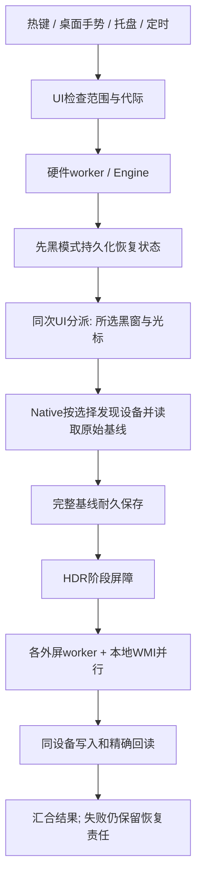

# screen-toggle v0.4.0 与 Twinkle Tray：功能、流程、架构及扩展路线

作者：shiranzby 项目研究文档 · 核查日期：2026-11-04（Asia/Singapore）

本工具：[shiranzby/screen-toggle](https://github.com/shiranzby/screen-toggle) · [v0.4.0 发布](https://github.com/shiranzby/screen-toggle/releases/tag/v0.4.0) · [当前源码架构](ARCHITECTURE.md) · [发行验证](VALIDATION.md)

研究边界：读取 Twinkle Tray 官方网站、官方发行记录和固定提交源码，没有安装或运行 Twinkle Tray，也没有测它的内存、CPU或操作时长。本工具按本次 v0.4.0 源码及绑定哈希的测试记录判断。代码中有功能、实际设备支持、当次实测通过是三个不同层次；以下明确区分。

## 阅读提要

1. **可以向多屏显示控制器扩展。** 当前 v0.4.0 的熄亮恢复能力适合作为基础，但要覆盖 Twinkle Tray，首先应补逐屏亮度面板、连续调节合并、设备校准和预设。仅增加更多熄屏选项，无法替代日常亮度管理。
2. **Twinkle Tray 的 Windows 界面值得学习。** 它实际是 Electron + React + CSS/SCSS + C++ 原生模块实现的 Windows/Fluent 风格界面，不是 WinUI 3 原生 XAML 应用。样式优势与 Electron 成本应分别评价。
3. **保留本项目的原生轻量与恢复事务。** 软件黑窗、捕获排除、指针策略、按完整身份保存基线、写入 ACK 提前显示和后台精确回读，是区别于一般亮度面板的价值。
4. **Electron 有运行时和多进程成本，也提供隔离与成熟 UI 工具。** 不能由框架推出 DDC 总线必然更慢；本次没有两款软件同口径 A/B，更不能编造“快几倍、少几百 MB”。
5. **优先级建议：可靠性与设备状态 → 常用亮度控制 → 预设及自动化 → 高级 VCP / HDR / 传感器。** 暂时维持 Rust 后端，WinUI 3 若要采用，应先做独立 UI 原型和部署评估，再决定是否迁移。

## 1. 版本与引用口径

本工具本次固定为 **v0.4.0**，发行 EXE SHA-256：`08485c627b1b00a888d94ed95ec50119457731785821dd36d1c2238cdbd3ae17`。历史 v0.3.0 和此前本地候选的数字不会冒充本发行结果。Twinkle Tray 的稳定、beta 和 master 如下；后文未注明版本的 Twinkle 实现默认指稳定版。

### 固定版本，避免把开发分支当成已发布功能

通过官方 Releases API、commit API、官网和本地 `git show` 交叉核对：

| 口径 | 标签 / 提交 | 发布 / 提交时间 | package 版本 | Electron 声明 / lock 实际 |
| --- | --- | --- | --- | --- |
| 最新稳定发行 | `v1.17.2`，`0ffa0ac5aa5af31affee69dd18796d6897646a07` | 发布 2025-12-25 14:48:22 UTC | 1.17.2 | `^39.2.6` / **39.2.7** |
| 最新预发行 | `v1.18.0-beta2`，`4c2f3e321bffcb2de897d9b08810c33c047c090c` | 发布 2026-08-13 17:42:13 UTC | 1.18.0-beta2 | `^43.1.1` / **43.1.1** |
| 当前开发分支 | `master`，`f4b36e12e2dbedd415a588b9baa2b8c65cf01f30` | 提交 2026-10-21 06:36:00 UTC | 仍写 1.18.0-beta2 | `^43.4.0` / **43.4.0** |

官网当前下载也指向 v1.17.2。master 的 package 版本与 beta2 相同，源码提交却不同，因此不能仅凭 package 版本将两者视为同一实现。[官网](https://twinkletray.com/)；[稳定 Release](https://github.com/xanderfrangos/twinkle-tray/releases/tag/v1.17.2)；[预发行 Release](https://github.com/xanderfrangos/twinkle-tray/releases/tag/v1.18.0-beta2)；[官方版本 API](https://api.github.com/repos/xanderfrangos/twinkle-tray/releases?per_page=20)。

精确依赖来源：[稳定 package.json，174–190 行](https://github.com/xanderfrangos/twinkle-tray/blob/0ffa0ac5aa5af31affee69dd18796d6897646a07/package.json#L174-L190)，[稳定 lock 的 Electron，8162 行](https://github.com/xanderfrangos/twinkle-tray/blob/0ffa0ac5aa5af31affee69dd18796d6897646a07/package-lock.json#L8162-L8179)；[beta2 lock，8023 行](https://github.com/xanderfrangos/twinkle-tray/blob/4c2f3e321bffcb2de897d9b08810c33c047c090c/package-lock.json#L8023-L8041)；[master package](https://github.com/xanderfrangos/twinkle-tray/blob/f4b36e12e2dbedd415a588b9baa2b8c65cf01f30/package.json#L200-L216)，[master lock](https://github.com/xanderfrangos/twinkle-tray/blob/f4b36e12e2dbedd415a588b9baa2b8c65cf01f30/package-lock.json#L8023-L8041)。后文未特别标明的实现均指稳定版 v1.17.2。

## 2. 技术栈：界面风格与运行时分开判断

### 技术栈与 UI 的真实实现

- 桌面壳是 Electron，主入口为 `src/electron.js`。面板、设置、介绍页分别是 BrowserWindow 加 preload、HTML 和 renderer bundle。[package 入口](https://github.com/xanderfrangos/twinkle-tray/blob/0ffa0ac5aa5af31affee69dd18796d6897646a07/package.json#L1-L21)；[面板窗口](https://github.com/xanderfrangos/twinkle-tray/blob/0ffa0ac5aa5af31affee69dd18796d6897646a07/src/electron.js#L2521-L2555)；[设置窗口](https://github.com/xanderfrangos/twinkle-tray/blob/0ffa0ac5aa5af31affee69dd18796d6897646a07/src/electron.js#L3580-L3617)。
- UI 使用 **React 18.3.1、react-dom 18.3.1、SCSS/Sass、Parcel 1.12.5**。`panel.js` 与 `settings.js` 实际调用 React `createRoot(...).render(...)`。拖动排序使用 react-beautiful-dnd。稳定版 package 与 lock 中没有 Fluent UI、WinUI 3、Windows App SDK 或 XAML UI 依赖。准确称呼是“Electron / React 实现的 Windows 风格界面”，不能说“WinUI 3 原生控件”。[依赖](https://github.com/xanderfrangos/twinkle-tray/blob/0ffa0ac5aa5af31affee69dd18796d6897646a07/package.json#L174-L190)；[panel.js](https://github.com/xanderfrangos/twinkle-tray/blob/0ffa0ac5aa5af31affee69dd18796d6897646a07/src/panel.js#L1-L18)；[settings.js](https://github.com/xanderfrangos/twinkle-tray/blob/0ffa0ac5aa5af31affee69dd18796d6897646a07/src/settings.js#L1-L22)；[SCSS 的 Win11 分支](https://github.com/xanderfrangos/twinkle-tray/blob/0ffa0ac5aa5af31affee69dd18796d6897646a07/src/css/common.scss#L1-L35)。
- Fluent 图标和可变字体由字体可用性探测及 DOM dataset 控制。窗口圆角、深色边框、Mica/Acrylic 材质也有 C++ addon 调 DWM / 窗口 composition API；**用了原生窗口材质，不代表内容控件变成 WinUI**。[字体探测](https://github.com/xanderfrangos/twinkle-tray/blob/0ffa0ac5aa5af31affee69dd18796d6897646a07/src/panel-preload.js#L96-L119)；[DWM 材质](https://github.com/xanderfrangos/twinkle-tray/blob/0ffa0ac5aa5af31affee69dd18796d6897646a07/src/modules/tt-windows-utils/windows_window_material.cc#L1-L20)；[Acrylic 原生实现](https://github.com/xanderfrangos/twinkle-tray/blob/0ffa0ac5aa5af31affee69dd18796d6897646a07/src/modules/acrylic/acrylic.cc#L32-L68)。
- 原生能力通过仓库本地 Node addon 连接：`@hensm/ddcci`、`win32-displayconfig`、`wmi-bridge`、`windows-hdr`、`tt-windows-utils` 等；Apple Studio Display 另有 `studio-display-control`。不是用浏览器 DOM 直接操作 DDC。[本地模块依赖](https://github.com/xanderfrangos/twinkle-tray/blob/0ffa0ac5aa5af31affee69dd18796d6897646a07/package.json#L32-L49)。

微软将 WinUI 3 定义为 Windows App SDK 中的原生 XAML 界面框架，主要面向 C# 与 C++；这与浏览器渲染出的相似外观不同。[WinUI 3 官方说明](https://learn.microsoft.com/en-us/windows/apps/winui/winui3/)。

| 项目 | screen-toggle v0.4.0 | Twinkle Tray 稳定版 |
| --- | --- | --- |
| UI技术 | Win32 原生窗口和控件，GDI/GDI+统一绘制；Direct2D可选 | React 18、DOM/SCSS、Electron BrowserWindow；原生addon增强窗口材质 |
| 风格 | Windows/Fluent、浅深系统主题；自绘需要自行维护缩放和控件状态 | 紧贴Windows10/11托盘交互、主题、滑块及反馈，产品完整度更高 |
| 执行环境 | Rust编译的Windows x64单EXE，无Chromium/Node运行时 | Electron主进程、renderer、显示器Node子进程及原生模块 |
| 故障边界 | UI与阻塞硬件分线程，进程级崩溃仍可能影响全应用 | 设备执行子进程与renderer分离，代价是IPC和运行时维护 |
| 当前产品边界 | 临时选屏熄屏和精确恢复 | 日常多屏亮度/显示参数管理及自动化 |


## 3. 功能覆盖矩阵

“有”代表官方稳定源码或文档支持，仍受硬件限制；本工具列描述v0.4.0，规划不计入已实现。

### 用户功能矩阵：亮度与设备

| 功能/场景 | Twinkle Tray stable v1.17.2 | screen-toggle v0.4.0 | 覆盖与取舍 |
| --- | --- | --- | --- |
| 托盘逐屏亮度滑块与数字输入 | 有；面板逐屏显示并可输入数值。[Slider](https://github.com/xanderfrangos/twinkle-tray/blob/0ffa0ac5aa5af31affee69dd18796d6897646a07/src/components/Slider.jsx#L73) | **无日常亮度滑块**；已有逐屏选择熄屏范围、DDC/WMI 压暗和原值恢复。 | P1，另设“亮度”操作，不能混用熄屏恢复基线。 |
| 联动全部屏幕亮度 | 有；切换 linked levels 后显示统一滑块。[BrightnessPanel](https://github.com/xanderfrangos/twinkle-tray/blob/0ffa0ac5aa5af31affee69dd18796d6897646a07/src/components/BrightnessPanel.jsx#L217) | 熄屏批次跨屏并行，但不是按百分比同步调亮度。 | P1；可见百分比先经过逐屏映射。 |
| 任意子集/分组 | 热键动作可指定多个屏；profiles 保存逐屏值。没有据此证明独立的通用“组管理器”。[热键配置](https://github.com/xanderfrangos/twinkle-tray/blob/0ffa0ac5aa5af31affee69dd18796d6897646a07/src/components/SettingsWindow.jsx#L733) | 保存完整设备身份列表；None 全部含未来屏，离线不回退；恢复范围由 journal 决定。 | 当前选屏继续作为范围基础；P1 再定义可命名亮度预设。 |
| DDC/CI 外屏、WMI 内屏 | 有；Monitors worker 分别处理。[Monitors](https://github.com/xanderfrangos/twinkle-tray/blob/0ffa0ac5aa5af31affee69dd18796d6897646a07/src/Monitors.js) | 已实现，独立设备并行、同屏串行，完整回读。 | 保留原生后端，优先借鉴能力探测和失败隔离。 |
| 屏幕自定义名称、排序 | 有，rename 与拖动排序。[设置](https://github.com/xanderfrangos/twinkle-tray/blob/0ffa0ac5aa5af31affee69dd18796d6897646a07/src/components/SettingsWindow.jsx#L1353) | 只有系统名称/显示源和内外屏标识，未见用户别名/排序。 | P1；显示别名不能成为写硬件身份。 |
| 隐藏屏幕、合盖隐藏内屏 | 有；隐藏显示器、隐藏非活动内屏；v1.16.0 说明隐藏屏不受亮度更新影响。[设置](https://github.com/xanderfrangos/twinkle-tray/blob/0ffa0ac5aa5af31affee69dd18796d6897646a07/src/components/SettingsWindow.jsx#L1349) | 已有“选择控制的屏幕”，含离线保留；这不是仅隐藏列表的 UI 偏好。 | P1，区分“隐藏行”和“禁止操作”，防把隐藏当授权。 |
| min/max 亮度归一化 | 有，逐屏限定范围。[设置](https://github.com/xanderfrangos/twinkle-tray/blob/0ffa0ac5aa5af31affee69dd18796d6897646a07/src/components/SettingsWindow.jsx#L453) | 保留硬件 min/current/max 用于熄屏与恢复，无用户校准范围。 | P1；journal 必须存硬件原值，不能存归一化百分比。 |
| 自定义校准点/亮度曲线 | **v1.17.2 stable 新增**，不是 beta 专属。[Release](https://github.com/xanderfrangos/twinkle-tray/releases/tag/v1.17.2) · [映射函数](https://github.com/xanderfrangos/twinkle-tray/blob/0ffa0ac5aa5af31affee69dd18796d6897646a07/src/Utils.js#L292) | 无。 | P1 后段；需单调、边界和反向映射测试。 |
| 持续读取外部 OSD 变化 | 可选打开面板时读取当前亮度/VCP；刷新频率可调。[功能设置](https://github.com/xanderfrangos/twinkle-tray/blob/0ffa0ac5aa5af31affee69dd18796d6897646a07/src/components/SettingsWindow.jsx#L1386) | 每轮熄屏采真实基线，恢复读 journal；没有日常轮询同步 OSD 的产品功能。 | P0 保证每轮基线正确；P1 面板按需读，避免后台高频 DDC。 |
| 启动/唤醒/热插后重应用亮度 | stable 有保存已知亮度、恢复延时及自动应用开关。[恢复逻辑](https://github.com/xanderfrangos/twinkle-tray/blob/0ffa0ac5aa5af31affee69dd18796d6897646a07/src/electron.js#L3960) | 有异常重启 journal 恢复和显示拓扑变化处理；未实现完整“始终维持用户亮度”服务。 | P0 事件后重绑、保留未完成恢复；P1 再做维持策略。 |
| Apple Studio Display | v1.16.0 stable 已加入独立模块；兼容特性不完全。[Release](https://github.com/xanderfrangos/twinkle-tray/releases/tag/v1.16.0) · [依赖](https://github.com/xanderfrangos/twinkle-tray/blob/0ffa0ac5aa5af31affee69dd18796d6897646a07/package.json#L49) | 无 Apple 专用协议。 | P2，必须有对应硬件与明确需求。 |
| 光标隐藏/保留、捕获排除黑窗 | 本次没查到等同 screen-toggle 的持久黑窗+光标策略；“关闭显示器”走系统信号/DDC 电源。 | 已有，且选屏黑窗、部分屏时保留全局指针。 | 属于现有工具核心，不应为亮度管理丢失。 |

### 用户功能矩阵：入口、自动化与高级控制

| 功能/场景 | Twinkle Tray stable v1.17.2 | screen-toggle v0.4.0 | 覆盖与取舍 |
| --- | --- | --- | --- |
| 托盘图标滚轮调亮度 | 有，可配步长和反向。[设置文案](https://github.com/xanderfrangos/twinkle-tray/blob/0ffa0ac5aa5af31affee69dd18796d6897646a07/src/localization/en.json#L83) | 无；当前全局/桌面触发用于明暗切换，设置面板滚轮用于滚页。 | P1，严格命中自有托盘图标才改值，不抢应用/网页滚轮。 |
| 全局亮度热键 | 可选单屏/多屏/全部，set、offset、cycle，多动作及 VCP。[热键动作 UI](https://github.com/xanderfrangos/twinkle-tray/blob/0ffa0ac5aa5af31affee69dd18796d6897646a07/src/components/SettingsWindow.jsx#L1735) | 全局/桌面各一套键鼠组合，独立双击开关；当前动作仅切换明暗。 | P1，在触发模型中增加显式动作，不能使旧组合语义改变。 |
| 亮度 OSD | 有热键/滚轮反馈，可配置 overlay 行为。[BrightnessPanel](https://github.com/xanderfrangos/twinkle-tray/blob/0ffa0ac5aa5af31affee69dd18796d6897646a07/src/components/BrightnessPanel.jsx) | 无亮度数值 OSD；黑窗不是 OSD。 | P1，可选小型不抢焦点提示；与黑窗生命周期分离。 |
| 固定时间多事件调光 | 有多时间点、逐屏值、过渡速度、连续插值、启动对齐。[时间设置](https://github.com/xanderfrangos/twinkle-tray/blob/0ffa0ac5aa5af31affee69dd18796d6897646a07/src/components/SettingsWindow.jsx#L1259) | 每日一个熄屏/一个亮屏时间，手动后10分钟让步。 | P1；原简单时刻保留，新增多事件亮度日程。 |
| 日出/日落调光 | stable 有太阳时刻；可手填经纬度或联网估算。[v1.16.0](https://github.com/xanderfrangos/twinkle-tray/releases/tag/v1.16.0) | 无。 | P2；默认手填/本地计算，位置查询必须用户主动请求。 |
| 空闲自动压暗/输入后恢复 | 有，可设秒/分钟，前台全屏和播放媒体时暂停。[设置文案](https://github.com/xanderfrangos/twinkle-tray/blob/0ffa0ac5aa5af31affee69dd18796d6897646a07/src/localization/en.json#L181) | 无空闲触发；当前桌面输入过滤不等同空闲检测。 | P1；暂时压暗应有独立基线/原因，不能污染手动熄屏。 |
| 锁屏时暂停、睡眠恢复 | stable 有 disable-on-lock 与唤醒事件恢复。[v1.17.0](https://github.com/xanderfrangos/twinkle-tray/releases/tag/v1.17.0) | 没有等同完整策略；不能把WM_DISPLAYCHANGE处理称锁屏/睡眠验证已通过。 | P0 生命周期安全，P1 再开放用户偏好。 |
| 手动预设/前台应用 profiles | stable 有逐屏预设、托盘菜单，EXE全/部分路径匹配前台应用；离开应用可恢复旧值。[设置](https://github.com/xanderfrangos/twinkle-tray/blob/0ffa0ac5aa5af31affee69dd18796d6897646a07/src/components/SettingsWindow.jsx#L1466) | 无。 | P1手动预设；P2前台应用自动化。官方明确不跟踪应用位于哪块屏。 |
| 对比度、音量 | stable DDC VCP 0x12、0x62；支持自定范围及与亮度联动。[DDCCISliders](https://github.com/xanderfrangos/twinkle-tray/blob/0ffa0ac5aa5af31affee69dd18796d6897646a07/src/components/DDCCISliders.jsx#L61) | 无用户功能。 | P2，只对已验证能力显示，和亮度事务隔离。 |
| 输入源切换 | v1.17.1 stable 加入 flyout 0x60 输入按钮。[v1.17.1](https://github.com/xanderfrangos/twinkle-tray/releases/tag/v1.17.1) · [源码](https://github.com/xanderfrangos/twinkle-tray/blob/0ffa0ac5aa5af31affee69dd18796d6897646a07/src/components/DDCCISliders.jsx#L74) | 无。 | P2；切走输入可使DDC丢失，不能等同可恢复亮度写。 |
| 显示器电源/待机 | stable 可用系统关闭显示信号、DDC 0xD6 或两者，DDC唤醒依赖硬件。[sleepDisplays](https://github.com/xanderfrangos/twinkle-tray/blob/0ffa0ac5aa5af31affee69dd18796d6897646a07/src/electron.js#L2301) | 当前是软件黑窗+调背光，保持显示输出；没有DDC电源关机用户入口。 | P2可选“物理待机”，不能替换现在远控仍工作的模式。 |
| 任意VCP、自定义主滑块VCP | stable 支持；v1.17.2可直接配置主滑块码，不只旧版手改JSON。[v1.17.2](https://github.com/xanderfrangos/twinkle-tray/releases/tag/v1.17.2) · [MonitorFeatures](https://github.com/xanderfrangos/twinkle-tray/blob/0ffa0ac5aa5af31affee69dd18796d6897646a07/src/components/MonitorFeatures.jsx) | 无通用VCP用户入口，当前外屏亮度用已知接口。 | P2专家模式；默认不开任意写，不运行穷举VCP。 |
| HDR显示器中调整SDR亮度 | **v1.17.0 stable已有**附加SDR滑块，也可替代主滑块；v1.17.2补仅HDR可调设备。[HDRSliders](https://github.com/xanderfrangos/twinkle-tray/blob/0ffa0ac5aa5af31affee69dd18796d6897646a07/src/components/HDRSliders.jsx) · [原生扩展](https://github.com/xanderfrangos/twinkle-tray/blob/0ffa0ac5aa5af31affee69dd18796d6897646a07/src/modules/windows-hdr/windows-hdr.cc#L19) | 只有熄屏时可选关HDR/恢复；无SDR白级滑块。 | P2，不混为“调HDR面板物理背光”；需要系统版本与颜色管理回归。 |
| Gamma软件调光/突破硬件最低亮度 | **stable未有；beta2新增**。[beta2](https://github.com/xanderfrangos/twinkle-tray/releases/tag/v1.18.0-beta2) | 无Gamma修改，已有黑窗软件遮挡。 | P2实验项，不能假定比黑窗更稳、更快。 |
| 环境光传感器自动亮度 | **stable未有；beta1新增**内置Windows传感器、Yocto传感器与逐屏范围。[beta1](https://github.com/xanderfrangos/twinkle-tray/releases/tag/v1.18.0-beta1) | 无。 | P2，没硬件不作兼容承诺。 |

### 集成、分发、界面与未知项

| 项目 | Twinkle Tray 证据与限制 | screen-toggle v0.4.0 / 建议 |
| --- | --- | --- |
| CLI | stable 支持 `--List`、编号/ID/All、Set/Offset/VCP、Overlay/Panel；请求需常驻实例。另源码解析 `--UseTime`、`--UDP`。[固定README](https://github.com/xanderfrangos/twinkle-tray/blob/0ffa0ac5aa5af31affee69dd18796d6897646a07/README.md#command-line-arguments) · [Utils](https://github.com/xanderfrangos/twinkle-tray/blob/0ffa0ac5aa5af31affee69dd18796d6897646a07/src/Utils.js#L63) | 当前只启动/独立目录/诊断参数，未有用户级list/set/offset/toggle命令协议。P1优先本机CLI。 |
| 网络/API/server | stable源码有**可选UDP4 server**，默认关闭；默认localhost，远程开关放开绑定，校验配置key；另有本地named pipe。debug设置有入口。[server](https://github.com/xanderfrangos/twinkle-tray/blob/0ffa0ac5aa5af31affee69dd18796d6897646a07/src/electron.js#L4842) · [设置](https://github.com/xanderfrangos/twinkle-tray/blob/0ffa0ac5aa5af31affee69dd18796d6897646a07/src/components/SettingsWindow.jsx#L1536) | 不能说Twinkle Tray无API；也未发现官方HTTP REST/cloud server。screen-toggle无此功能，P2才考虑网络，P1用当前用户ACL的本地pipe。 |
| UDP命令范围 | stable handler有list、get、set/setvcp、checktime、refresh；key不是加密，源码不等同正式稳定公共网络API契约。[handler](https://github.com/xanderfrangos/twinkle-tray/blob/0ffa0ac5aa5af31affee69dd18796d6897646a07/src/electron.js#L4699) | 不复制partial-ID匹配到硬件操作，保留完整稳定身份/目标消失拒绝原则。 |
| 更新 | stable有自动检查、提示后下载安装、stable/beta频道；Store通过Store更新。[更新设置](https://github.com/xanderfrangos/twinkle-tray/blob/0ffa0ac5aa5af31affee69dd18796d6897646a07/src/components/SettingsWindow.jsx#L1492) | 当前手动GitHub Release。P1先版本检查+用户启动下载；P2再原子替换/签名自动更新。 |
| 安装/免安装 | 官网提供GitHub EXE installer及Microsoft Store。当前stable Release只列一份EXE资产；源码有portable ZIP构建，旧Wiki讲解包installer，**不能声称有官方当前portable下载包**。[官网](https://twinkletray.com/) · [package](https://github.com/xanderfrangos/twinkle-tray/blob/0ffa0ac5aa5af31affee69dd18796d6897646a07/package.json#L8) | 当前单EXE，无安装器；便携配置目录需显式 `--data-dir`，尚无“EXE旁自动portable模式”约定。 |
| x64 / ARM64 | package有x64 installer、ARM64与Store ARM64构建脚本；当前GitHub v1.17.2资产无独立ARM64 EXE。Store现网每架构版本未核实，标未知。[构建脚本](https://github.com/xanderfrangos/twinkle-tray/blob/0ffa0ac5aa5af31affee69dd18796d6897646a07/package.json#L8) | screen-toggle当前只交付Windows x64，P2原生ARM64编译和真机验证。 |
| 国际化 | 官网称20余语言；stable tag包含37个locale JSON，完整度不一且不等于37语种全覆盖。[locale目录](https://github.com/xanderfrangos/twinkle-tray/tree/0ffa0ac5aa5af31affee69dd18796d6897646a07/src/localization) | 当前中文硬编码。P1集中字符串资源，P2语言包/RTL。 |
| 主题和系统风格 | stable浅/深/跟系统、Win10/Win11外观、可选Acrylic/Mica相关表现；beta1才明确“真正Windows11 Mica背景”。[稳定设置](https://github.com/xanderfrangos/twinkle-tray/blob/0ffa0ac5aa5af31affee69dd18796d6897646a07/src/components/SettingsWindow.jsx) · [beta1](https://github.com/xanderfrangos/twinkle-tray/releases/tag/v1.18.0-beta1) | 当前原生Win32/Fluent、浅深系统主题，默认GDI；不必追随其Electron/React实现。 |
| 无障碍/键盘/高对比 | stable滑块使用HTML原生range和number；若干图标使用div点击。未运行Narrator/完整键盘/高对比回归，**完整可访问性未知**。[Slider](https://github.com/xanderfrangos/twinkle-tray/blob/0ffa0ac5aa5af31affee69dd18796d6897646a07/src/components/Slider.jsx#L78) | 原生控件保留状态/Tab/录入，但自绘也需MSAA/UIA名称、角色、状态和Narrator实测。列P0发布门槛，不宣称天然全部无障碍。 |
| 排障 | stable有检测方法开关、刷新/清cache/导出报告、延时与恢复策略；beta1增加自动安全回退和临时通信重试。[stable设置](https://github.com/xanderfrangos/twinkle-tray/blob/0ffa0ac5aa5af31affee69dd18796d6897646a07/src/components/SettingsWindow.jsx#L1510) · [beta1](https://github.com/xanderfrangos/twinkle-tray/releases/tag/v1.18.0-beta1) | 当前有隔离测试/阶段trace、精确回读及失败journal，本地开发入口较多，面向用户诊断页不足。P0做可读状态和导出。 |
| 许可/技术栈 | MIT；Electron、React、Node.js及原生扩展；**不是WinUI3**。[package](https://github.com/xanderfrangos/twinkle-tray/blob/0ffa0ac5aa5af31affee69dd18796d6897646a07/package.json) | Rust/windows-rs/Win32，MIT。复用代码须保留许可；本计划优先借鉴行为和设计，不直接移植JS架构。 |
| 资源/速度对照 | 本次未运行Twinkle Tray，因此没有双方同机同设备的内存/延迟对照。下载installer体积和裸EXE体积口径也不同。 | 可引用本工具绑定哈希的本版资源/延迟证据，但不能据此声称“比Twinkle Tray省X%/快X倍”。 |
| 夜间模式/蓝光/Windows快捷设置 | 旧FAQ明确无Night light集成/无Quick Settings扩展官方接口；本次stable源码未找到用户级相应集成。[FAQ](https://github.com/xanderfrangos/twinkle-tray/wiki/Common-requests-%26-FAQs) | 不在P0/P1范围；Gamma调暗也不能称夜间模式。 |

## 4. 本工具当前架构与操作流程

### 当前职责

| 层 | 文件 | 当前职责与边界 |
| --- | --- | --- |
| 入口、UI协调 | `main.rs`、`app.rs` | 单实例、托盘、热键、命令代际、保存线程、硬件worker；本版Operation只有Dark/Light/Measure/Quit |
| Windows界面 | `panel.rs`、`display_picker.rs`、`about.rs`、`theme.rs` | 设置、选屏、主题与关于；没有日常逐屏百分比调光flyout |
| 输入验证 | `desktop_mouse.rs` | 低级钩子只采样；有界队列与独立COM验证线程判断桌面或自有可见黑窗 |
| 领域恢复 | `engine.rs` | 原始基线、持久journal、取消、HDR依赖、亮度写ACK和精确回读；失败项保留 |
| 原生provider | `native.rs` | QueryDisplayConfig、DDC高层亮度、WMI COM、HDR；选屏在硬件访问前过滤 |
| 配置和时间 | `config.rs`、`storage.rs`、`schedule.rs` | 自动保存、原子替换、完整屏幕ID、每日熄亮时刻、手动操作让步 |

### 用户操作到真实熄屏



上图描述默认先黑模式。先熄后黑的呈现时机不同，generation检查、硬件改动前持久化基线和恢复责任仍存在。黑窗按所选屏幕矩形的并集设置region，不把中间空隙和未选屏盖黑。

### 恢复为何既能快又不能省略确认

```mermaid
sequenceDiagram
  participant UI as UI线程
  participant E as Engine/协调worker
  participant D as 各设备通道
  UI->>E: Light + 新generation
  E->>E: 读取本轮journal / 重绑资源
  E->>D: 恢复HDR并确认
  E->>D: 各通道写原始亮度
  D-->>E: 所有请求写入成功
  E-->>UI: 一次呈现ACK请求
  UI->>UI: 撤所选黑窗 / 恢复光标
  par 继续回读
    D->>D: fresh read逐设备核对
  and UI可以响应
    UI->>UI: 用户继续操作
  end
  D-->>E: 确认或失败
  E->>E: 只清已确认项; HDR失败保留亮度依赖
```

正常恢复只重新绑定资源，不把已经压暗的当前值重新采成原值；失败恢复才允许一次有限重试。切换新范围之前先承担旧journal的恢复责任。`Presented::scan_selected` 必须转发Native前置过滤，不能先读所有显示器再筛结果。

### 当前缺口

目前没有“用户日常期望亮度”的独立模型。直接把SetBrightness塞进Dark/Light会混淆暂时压暗、真实原值、用户新意图和自动化恢复。因此，扩展前先区分常规用户设定与临时覆盖原因，再复用现有设备执行器。无需为每个入口各建一套DDC服务。


## 5. Twinkle Tray 的进程、设备和时序

### 分层与进程架构

| 层 | 主要文件 | 职责和实际边界 |
| --- | --- | --- |
| Electron 主进程 | `src/electron.js` | app 生命周期、托盘、BrowserWindow、设置、热键、空闲/唤醒、定时、更新；持有用于 UI 的 `monitors` 模型 |
| React renderer | `components/BrightnessPanel.jsx`、`SettingsWindow.jsx`、`Slider.jsx` | 滑块、设置、主题、拖动排序；先更新交互状态，再通过 preload 发消息 |
| preload 桥 | `panel-preload.js`、`settings-preload.js` | `ipcRenderer.send` 与主进程事件到 DOM CustomEvent 的桥 |
| 显示器执行进程 | `src/Monitors.js` | 设备探测、亮度/功能读取和写入、provider 降级、VCP 与能力缓存 |
| 原生 addon | `src/modules/*` | N-API -> DXVA2、WMI COM、QueryDisplayConfig、HDR/SDR 白点、窗口材质等 Windows 能力 |

源码把 Monitors.js 称作 “thread”，实际是 **`child_process.fork` 独立 Node 子进程**，不是 `worker_threads.Worker`。主进程通过 `.send(...)`、子进程通过 `process.on('message')` / `process.send(...)` 通信。阻塞的原生调用主要发生在该子进程，因此即使设备通信慢，也不必直接卡住 React renderer。[启动与 IPC：electron.js 138–238 行](https://github.com/xanderfrangos/twinkle-tray/blob/0ffa0ac5aa5af31affee69dd18796d6897646a07/src/electron.js#L138-L238)；[worker dispatch](https://github.com/xanderfrangos/twinkle-tray/blob/0ffa0ac5aa5af31affee69dd18796d6897646a07/src/Monitors.js#L25-L113)。

#### 稳定版普通滑块链路

```text
Slider onChange
  -> BrightnessPanel 本地 React 状态（levelsChanged）
  -> syncBrightness 定期提交变化
  -> window.updateBrightness
  -> panel-preload: ipcRenderer.send('update-brightness')
  -> electron.js: updateBrightness / 范围校准 / 路由
  -> fork IPC: {type:'brightness', id, brightness}
  -> Monitors.js: setBrightness
  -> N-API addon
  -> SetMonitorBrightness 或 SetVCPFeature / WmiSetBrightness
```

精确入口：[BrightnessPanel 139–170 行](https://github.com/xanderfrangos/twinkle-tray/blob/0ffa0ac5aa5af31affee69dd18796d6897646a07/src/components/BrightnessPanel.jsx#L139-L170)；[preload 86–94 行](https://github.com/xanderfrangos/twinkle-tray/blob/0ffa0ac5aa5af31affee69dd18796d6897646a07/src/panel-preload.js#L86-L94)；[主进程 update-brightness handler](https://github.com/xanderfrangos/twinkle-tray/blob/0ffa0ac5aa5af31affee69dd18796d6897646a07/src/electron.js#L2379-L2391)；[主路由 1992–2138 行](https://github.com/xanderfrangos/twinkle-tray/blob/0ffa0ac5aa5af31affee69dd18796d6897646a07/src/electron.js#L1992-L2138)；[worker 写入 926–957 行](https://github.com/xanderfrangos/twinkle-tray/blob/0ffa0ac5aa5af31affee69dd18796d6897646a07/src/Monitors.js#L926-L957)。

**重要口径：**主进程/worker 会先更新模型值，原生成功不等于每次都有独立、精确、同步的硬件回读确认。稳定版 brightness dispatch 没有逐次回传“写入后 fresh read == 请求值”的事务 ACK；后续刷新还可能读取缓存。因此不能把 UI 滑块即时变化或 IPC 投递完成称为硬件完全恢复。[模型更新和 send](https://github.com/xanderfrangos/twinkle-tray/blob/0ffa0ac5aa5af31affee69dd18796d6897646a07/src/electron.js#L2043-L2138)；[setVCP 更新缓存](https://github.com/xanderfrangos/twinkle-tray/blob/0ffa0ac5aa5af31affee69dd18796d6897646a07/src/Monitors.js#L1045-L1058)。这是针对所追踪链路的判断，不是声称软件从不读取亮度。

### 设备发现与路由

稳定版完整刷新串接 WMIC / WMI、Win32 设备详细信息、Apple Studio、DDC 功能、内置亮度和 HDR 等来源，合并成统一 monitor 模型；不是看到 `async/await` 就能判断三屏硬件已并行。[getAllMonitors，245–440 行](https://github.com/xanderfrangos/twinkle-tray/blob/0ffa0ac5aa5af31affee69dd18796d6897646a07/src/Monitors.js#L245-L440)。

- 内屏：稳定版先尝试 WMIC；WMIC 不可用且 bridge 允许时走原生 WMI。普通 WMI 写入分支选出第一个 `type=='wmi'`，addon 再取第一条 `WmiMonitorBrightnessMethods` 实例调用方法；并不是与我们一样让每个 journal 设备完整身份贯穿方法调用。没有 bridge 时还有 PowerShell 回退。[稳定 provider 顺序](https://github.com/xanderfrangos/twinkle-tray/blob/0ffa0ac5aa5af31affee69dd18796d6897646a07/src/Monitors.js#L245-L278)；[写入与回退](https://github.com/xanderfrangos/twinkle-tray/blob/0ffa0ac5aa5af31affee69dd18796d6897646a07/src/Monitors.js#L926-L957)；[方法查询及取一条](https://github.com/xanderfrangos/twinkle-tray/blob/0ffa0ac5aa5af31affee69dd18796d6897646a07/src/modules/wmi-bridge/wmi-bridge.cc#L383-L411)；[ExecMethod](https://github.com/xanderfrangos/twinkle-tray/blob/0ffa0ac5aa5af31affee69dd18796d6897646a07/src/modules/wmi-bridge/wmi-bridge.cc#L466-L486)。
- 外屏：本地 `node-ddcci` 通过 EnumDisplayDevices / EnumDisplayMonitors 获取逻辑显示关系，再拿物理显示器句柄；高层接口用 Get/SetMonitorBrightness，低层接口用 GetVCPFeatureAndVCPFeatureReply / SetVCPFeature。[原生发现与句柄](https://github.com/xanderfrangos/twinkle-tray/blob/0ffa0ac5aa5af31affee69dd18796d6897646a07/src/modules/node-ddcci/ddcci.cc#L170-L284)；[低层读写](https://github.com/xanderfrangos/twinkle-tray/blob/0ffa0ac5aa5af31affee69dd18796d6897646a07/src/modules/node-ddcci/ddcci.cc#L842-L906)；[高层读写](https://github.com/xanderfrangos/twinkle-tray/blob/0ffa0ac5aa5af31affee69dd18796d6897646a07/src/modules/node-ddcci/ddcci.cc#L932-L999)。
- 显示身份、名称和源路径来自多个 provider 合并。Win32 addon 用 QueryDisplayConfig / DisplayConfigGetDeviceInfo；worker 常以 `hwid[2]` 为模型 key，并有部分/前缀 ID 查找。它面向便捷调光控制；我们的恢复白名单仍应坚持完整身份精确匹配，不能照搬部分匹配。[Win32 拓扑](https://github.com/xanderfrangos/twinkle-tray/blob/0ffa0ac5aa5af31affee69dd18796d6897646a07/src/modules/win32-displayconfig/win32-displayconfig.cc#L213-L285)；[合并与 key](https://github.com/xanderfrangos/twinkle-tray/blob/0ffa0ac5aa5af31affee69dd18796d6897646a07/src/Monitors.js#L317-L363)；[主进程 ID 前缀](https://github.com/xanderfrangos/twinkle-tray/blob/0ffa0ac5aa5af31affee69dd18796d6897646a07/src/electron.js#L2004-L2020)。

#### VCP 与能力发现

自动探测支持 fast、accurate、no-validation、legacy 策略。它读取 capabilities 字符串来跳过不支持的 VCP，并允许用户为某型号指定亮度 VCP；常见候选有 0x10、0x13、0x6B，后面还可退到对比度 0x12。[策略选择](https://github.com/xanderfrangos/twinkle-tray/blob/0ffa0ac5aa5af31affee69dd18796d6897646a07/src/Monitors.js#L449-L457)；[能力探测与自定义功能](https://github.com/xanderfrangos/twinkle-tray/blob/0ffa0ac5aa5af31affee69dd18796d6897646a07/src/Monitors.js#L706-L781)。

高层亮度可用且未设置自定义 VCP 时优先走高层写入，否则走低层 VCP。逻辑百分比先经 remap / calibration 再映射原始 max，便于不同屏幕亮度统一。[采样和比例](https://github.com/xanderfrangos/twinkle-tray/blob/0ffa0ac5aa5af31affee69dd18796d6897646a07/src/Monitors.js#L338-L363)；[写入路由](https://github.com/xanderfrangos/twinkle-tray/blob/0ffa0ac5aa5af31affee69dd18796d6897646a07/src/Monitors.js#L926-L945)；[主校准入口](https://github.com/xanderfrangos/twinkle-tray/blob/0ffa0ac5aa5af31affee69dd18796d6897646a07/src/electron.js#L2176-L2192)。

### HDR/SDR 与“熄屏”的边界

Twinkle Tray 稳定版的 HDR 相关滑块主要调 **HDR 模式中的 SDR 内容白点/亮度**。worker 把百分比映射到 80–480 nits，原生模块设置 SDR white level；这与关闭 HDR、改变物理背光、或创建黑色覆盖窗是不同操作。主滑块可对指定 HDR 屏改路由至 SDR 控制。[HDR 模型](https://github.com/xanderfrangos/twinkle-tray/blob/0ffa0ac5aa5af31affee69dd18796d6897646a07/src/Monitors.js#L505-L533)；[映射](https://github.com/xanderfrangos/twinkle-tray/blob/0ffa0ac5aa5af31affee69dd18796d6897646a07/src/Monitors.js#L915-L924)；[原生 SDR white level](https://github.com/xanderfrangos/twinkle-tray/blob/0ffa0ac5aa5af31affee69dd18796d6897646a07/src/modules/windows-hdr/windows-hdr.cc#L9-L29)；[范围限制](https://github.com/xanderfrangos/twinkle-tray/blob/0ffa0ac5aa5af31affee69dd18796d6897646a07/src/modules/windows-hdr/windows-hdr.cc#L54-L80)。

原生 SDR setter 使用内部枚举值 `0xFFFFFFEE` 调 DisplayConfigSetDeviceInfo，这是有 Windows 版本兼容风险的实现细节，不应因为效果像设置面板就当成长期稳定公开 API。这里“风险”是依据内部枚举名称和调用方式作出的工程判断，不是本次实机失败结论。

### 节流、缓存、超时和故障隔离

#### 节流究竟在哪里

- 默认 `updateInterval=500`。普通亮度面板用 `setInterval(syncBrightness, updateInterval)` 合并滑块变化，提交时仅发送值变化的屏。它影响连续拖动的写入频率，不是每个原生 API 都固定等待 500 ms。[默认设置](https://github.com/xanderfrangos/twinkle-tray/blob/0ffa0ac5aa5af31affee69dd18796d6897646a07/src/electron.js#L460-L487)；[面板定期提交](https://github.com/xanderfrangos/twinkle-tray/blob/0ffa0ac5aa5af31affee69dd18796d6897646a07/src/components/BrightnessPanel.jsx#L139-L170)。
- 热键/批量、VCP/SDR 等路径另有主进程 `updateBrightnessThrottle`。稳定版将同一 id 的 pending 更新替换为最后一条，并按 updateInterval 批量刷新；普通 renderer `update-brightness` handler 则直接调用 updateBrightness，不能把两条路径混为一谈。[主节流](https://github.com/xanderfrangos/twinkle-tray/blob/0ffa0ac5aa5af31affee69dd18796d6897646a07/src/electron.js#L1950-L1986)；[renderer handler](https://github.com/xanderfrangos/twinkle-tray/blob/0ffa0ac5aa5af31affee69dd18796d6897646a07/src/electron.js#L2379-L2387)；[VCP/SDR handler](https://github.com/xanderfrangos/twinkle-tray/blob/0ffa0ac5aa5af31affee69dd18796d6897646a07/src/electron.js#L2470-L2477)。
- 软刷新有约 5 秒间隔检查，刷新中拒绝再刷新；用户调光后可暂停采样 updateInterval×2。以上是防硬件被连续探测占满的策略，不能当作“硬件需 5 秒”解释。[刷新限流和排他](https://github.com/xanderfrangos/twinkle-tray/blob/0ffa0ac5aa5af31affee69dd18796d6897646a07/src/electron.js#L1829-L1866)；[暂停](https://github.com/xanderfrangos/twinkle-tray/blob/0ffa0ac5aa5af31affee69dd18796d6897646a07/src/electron.js#L1934-L1938)。

#### 缓存

worker 保存 VCP 值、capabilities raw/parsed、provider 上次结果；原生 DDC 模块保存句柄。能力缓存能减少探测、规避不支持代码。`checkVCP` 成功后默认再等待约 20 ms；失败允许返回旧缓存，写入后也直接把目标写进缓存。因此“缓存当前值”与“fresh hardware read”必须区别标注。[VCP cache 和读后等待](https://github.com/xanderfrangos/twinkle-tray/blob/0ffa0ac5aa5af31affee69dd18796d6897646a07/src/Monitors.js#L966-L1041)；[写后缓存](https://github.com/xanderfrangos/twinkle-tray/blob/0ffa0ac5aa5af31affee69dd18796d6897646a07/src/Monitors.js#L1045-L1058)。

#### 超时

稳定版 JS 包装有 WMI/Win32 4 秒、DDC 亮度 8 秒、全 DDC feature 扫描 80 秒/单屏 15 秒、主进程 refresh 60 秒等预算。**JS setTimeout 不能抢占同一个子进程内正在同步阻塞的 native API**：N-API 的 setVCP/getVCP 与高层亮度直接同步调用 Windows 函数，没有该层 AsyncWorker。主进程独立计时可以发现“worker 没回应”，但不代表底层 I²C 请求已被安全撤销。[worker 时间预算](https://github.com/xanderfrangos/twinkle-tray/blob/0ffa0ac5aa5af31affee69dd18796d6897646a07/src/Monitors.js#L535-L639)；[DDC 亮度预算](https://github.com/xanderfrangos/twinkle-tray/blob/0ffa0ac5aa5af31affee69dd18796d6897646a07/src/Monitors.js#L829-L842)；[主进程 60 秒](https://github.com/xanderfrangos/twinkle-tray/blob/0ffa0ac5aa5af31affee69dd18796d6897646a07/src/electron.js#L1795-L1825)；[同步 setter/getter](https://github.com/xanderfrangos/twinkle-tray/blob/0ffa0ac5aa5af31affee69dd18796d6897646a07/src/modules/node-ddcci/ddcci.cc#L842-L906)。

稳定版 monitor 子进程出错会提示并尝试重启；独立 wmi-bridge-test 进程用于检测 provider。其设计价值是把可卡死/崩溃的设备接口与 UI 进程隔开，而不是保证所有 API 都可中断。[worker error/restart](https://github.com/xanderfrangos/twinkle-tray/blob/0ffa0ac5aa5af31affee69dd18796d6897646a07/src/electron.js#L211-L238)；[WMI 测试进程](https://github.com/xanderfrangos/twinkle-tray/blob/0ffa0ac5aa5af31affee69dd18796d6897646a07/src/electron.js#L272-L310)。

### 设置、已知亮度与软件更新

- 设置读取先合并默认值，再升级旧字段、应用 theme/热键/调光策略；写设置将内存立即合并，延迟约 333 ms 后异步写 JSON。所审查 setter 采用直接 `fs.writeFile`，未看到临时文件+flush+原子替换的同级流程。[读取](https://github.com/xanderfrangos/twinkle-tray/blob/0ffa0ac5aa5af31affee69dd18796d6897646a07/src/electron.js#L563-L590)；[写入与处理](https://github.com/xanderfrangos/twinkle-tray/blob/0ffa0ac5aa5af31affee69dd18796d6897646a07/src/electron.js#L744-L776)。
- 不能说它“没有恢复亮度”：`known-displays.json` 保存已知屏幕和最后亮度，通常延后约 3 秒写入，可在唤醒/启动/配置场景重新应用；还有空闲前/应用配置前快照。**但这与 screen-toggle 每次硬件副作用前持久化原始基线、失败保留、fresh read确认后才清理的 recovery journal 是两种语义**。[known display 保存与重新应用](https://github.com/xanderfrangos/twinkle-tray/blob/0ffa0ac5aa5af31affee69dd18796d6897646a07/src/electron.js#L997-L1081)；[写入后触发保存](https://github.com/xanderfrangos/twinkle-tray/blob/0ffa0ac5aa5af31affee69dd18796d6897646a07/src/electron.js#L2123-L2138)；[空闲前快照](https://github.com/xanderfrangos/twinkle-tray/blob/0ffa0ac5aa5af31affee69dd18796d6897646a07/src/electron.js#L4095-L4110)。
- 更新检查向官方 GitHub releases API 请求列表，按分支设置排除 prerelease；默认每日一次，portable/AppX 分支跳过自有 updater。下载到本地后比较资产期望大小，启动安装程序并退出。这里按所见代码只确认文件大小检查，不能额外声称 updater 在此函数中核对了发行方 SHA256。[检查和选择](https://github.com/xanderfrangos/twinkle-tray/blob/0ffa0ac5aa5af31affee69dd18796d6897646a07/src/electron.js#L3689-L3732)；[下载](https://github.com/xanderfrangos/twinkle-tray/blob/0ffa0ac5aa5af31affee69dd18796d6897646a07/src/electron.js#L3740-L3785)；[校验大小与运行](https://github.com/xanderfrangos/twinkle-tray/blob/0ffa0ac5aa5af31affee69dd18796d6897646a07/src/electron.js#L3803-L3847)。

### beta2 与 master 的改进，必须单独标示

以下不是稳定 v1.17.2 的既有保证：

1. **beta2 已有：快速发现先完成，capabilities 后台 enrichment。**减少初始枚举被较危险、较慢的能力字符串阻塞；附 generation 的响应可拒绝旧刷新。[beta2 enrichment](https://github.com/xanderfrangos/twinkle-tray/blob/4c2f3e321bffcb2de897d9b08810c33c047c090c/src/Monitors.js#L603-L726)；[主进程 enrichment job](https://github.com/xanderfrangos/twinkle-tray/blob/4c2f3e321bffcb2de897d9b08810c33c047c090c/src/electron.js#L2467-L2507)。
2. **beta2 已有：DDC 风险操作哨兵和不稳定设备记录。**探测前记录 stage/id，正常结束清除；下次启动发现遗留会降级 fast，避免每次启动重复触发同类能力探测故障。这是“崩溃探测证据”，不是亮度原值恢复日志。[beta2 sentinel](https://github.com/xanderfrangos/twinkle-tray/blob/4c2f3e321bffcb2de897d9b08810c33c047c090c/src/Monitors.js#L309-L398)。
3. **beta2 已有：worker 消息串行 Promise 队列。**Node 的异步 EventEmitter listener 本身不会自动等待前一条 async 完成；显式 queue 防刷新、写入、capabilities、cache mutation 交错。[beta2 队列](https://github.com/xanderfrangos/twinkle-tray/blob/4c2f3e321bffcb2de897d9b08810c33c047c090c/src/Monitors.js#L2184-L2201)。
4. **beta2 已改为原生 WMI bridge 优先，WMIC 作为后备。**master 在此基础上进一步区分“确实有内屏却连续失败”和“桌面机器没有内屏”，避免空结果被误诊为 provider 失败；还明确同步原生 WMI 的 JS timeout 无法真正抢占。[beta2 provider](https://github.com/xanderfrangos/twinkle-tray/blob/4c2f3e321bffcb2de897d9b08810c33c047c090c/src/Monitors.js#L1184-L1228)；[master provider/同步说明](https://github.com/xanderfrangos/twinkle-tray/blob/f4b36e12e2dbedd415a588b9baa2b8c65cf01f30/src/Monitors.js#L1230-L1303)。
5. **master 当前：每个 monitor+VCP 独立 latest-wins 节流。**避免同一屏的亮度和联动 VCP 覆盖彼此队列；每目标有自己的 lastTime、pending、timer。[master throttle](https://github.com/xanderfrangos/twinkle-tray/blob/f4b36e12e2dbedd415a588b9baa2b8c65cf01f30/src/electron.js#L3052-L3099)。
6. **beta2 已有软件 gamma 调光，master 进一步维护相关边界。**代码按需启用 gamma API、HDR active 时回避 gamma、退出时重置自己管理的 ramp。不能将其软件亮度当作物理背光调光，也不能将这一预发行／开发能力计入稳定版。[master gamma](https://github.com/xanderfrangos/twinkle-tray/blob/f4b36e12e2dbedd415a588b9baa2b8c65cf01f30/src/Monitors.js#L20-L157)；[HDR/gamma边界](https://github.com/xanderfrangos/twinkle-tray/blob/f4b36e12e2dbedd415a588b9baa2b8c65cf01f30/src/electron.js#L1473-L1525)；[退出gamma处理](https://github.com/xanderfrangos/twinkle-tray/blob/f4b36e12e2dbedd415a588b9baa2b8c65cf01f30/src/electron.js#L1614-L1647)。

## 6. 优势、成本与可迁移经验

| 方面 | 本工具的价值与代价 | Twinkle Tray的价值与代价 | 对本项目的决定 |
| --- | --- | --- | --- |
| 日常操作 | 快速熄亮与选屏明确；缺少日常亮度控件 | 成熟的托盘逐屏滑块、wheel、OSD、校准和profiles | 优先补独立亮度面板，设置页只管理偏好 |
| 资源与分发 | 单EXE、无浏览器运行时；原生UI工程需要自己维护 | Chromium/Node与多进程有基线成本；UI迭代生态成熟 | 保持Rust设备内核；资源按实际进程树与场景测量 |
| 操作正确性 | 基线先落盘、依赖恢复、完整身份和fresh read；有准备I/O成本 | 已知亮度缓存、乐观UI与故障回退丰富；语义不是每次熄屏前的事务journal | 借鉴兼容性，不削弱恢复的确认口径 |
| 驱动隔离 | scoped worker能并发；线程无法隔离整个进程的原生崩溃 | 独立设备进程方便崩溃恢复；同步native调用仍不能被JS超时强制抢占 | 先保持现有线程；遇真实卡死证据再设计带journal所有权的helper进程 |
| UI一致性 | 小型紧凑；自绘焦点、缩放、无障碍仍需维护 | Windows风格细节完善；不是WinUI3原生控件 | 学习层次、控件反馈、图标和材料，避免照抄技术成本 |
| 长期维护 | Rust类型/RAII和较小依赖面有利；功能增长后app/native仍需拆分 | 功能面广、设备规则积累；较大的共享状态和依赖升级面 | 按命令/能力/provider分职责，避免继续堆大型条件分支 |
| 对外自动化 | 目前没有用户级调亮CLI/服务，攻击面较小 | CLI及默认关闭UDP功能较完整；网络与renderer权限需额外管理 | 先同用户本地pipe/CLI，网络自动化放后续可选功能 |

### 客观优缺点与对本项目的可迁移建议

#### 值得学习

| 可借鉴设计 | 原因 | screen-toggle 迁移边界 |
| --- | --- | --- |
| 逻辑拓扑、能力元数据、实时亮度分层缓存 | 减少重复发现与 capabilities 探测 | 实时恢复基线和精确回读不能用缓存替代 |
| Fast-first + 后台能力 enrichment（beta2） | 先展示可用屏，减少启动阻塞 | 保持设备身份与 generation，后续结果不能覆盖新拓扑 |
| 按 monitor+功能 latest-wins 合并（master） | 连续滑块操作减少冗余硬件请求 | 熄亮恢复命令有事务意义，不能直接丢掉已记录基线或中间恢复责任 |
| 明确 WMI/WMIC/高层DDC/低层VCP 的provider能力和失败原因 | 支持更多硬件和针对性排错 | 新provider必须保留完整身份、原值单位/范围和回读；不要偷偷用对比度代替背光 |
| 风险 capabilities 哨兵和手工重试入口（beta2） | 异常设备不必每次启动重演失败 | 它补充恢复journal，不能取代journal；只对风险探测写证据，不给正常切换增加同步磁盘等待 |
| 诊断报告展示provider、路径、原始范围、capabilities | 定位“未发现/不可写/回读错”更直接 | 默认日志避免无界增长；分清原始值、目标值和缓存值 |
| 独立硬件执行进程 | 驱动阻塞可与UI隔离，进程级崩溃易定位 | 进程恢复必须先确认旧请求停止和journal所有权，不能在旧worker仍写时启动另一套恢复 |

#### 不宜直接照搬或据此作出的错误结论

- **Electron 不等于 DDC 必然慢。**两款软件最终都可调用同类 Windows 原生 API，显示器总线/固件耗时与 UI 框架是不同层。Twinkle Tray 的 UI 进程与硬件进程分离，也能保持交互流畅。源码能说明路径，不足以给出谁的硬件写入更快。只有同设备、同原值、同provider、同回读口径的 A/B 才能比较。
- **“WinUI风格”不等于“WinUI3原生”。**本次依赖与渲染入口明确是 React/DOM/SCSS；native材质、系统字体和图标解释了其视觉融合。不能为保持Rust轻量就贬低这一视觉实现，也不需要引入Electron才能学习其布局和反馈。
- **快速乐观模型不等于精确恢复完成。**Twinkle Tray 长期调光器允许缓存/已知亮度恢复；screen-toggle 的临时熄屏需要保住“本次熄屏前原值”。应保留现有全写ACK快速显示、后台fresh read与失败journal，而不是为了表面更快取消确认。
- 稳定版大量 provider、UI、配置、定时、更新集中于较长的 `electron.js` 和 `Monitors.js`，维护时依赖较多共享状态。可迁移其明确能力分层，不宜原样搬入大文件。（这是结构评估，不是已证明某个用户故障。）
- 稳定窗口配置可见 `nodeIntegration:true`、`contextIsolation:false`；设置窗还配置 `webSecurity:false`、`allowRunningInsecureContent:true`。这些扩大renderer权限面的配置不适合作为新应用模板。这里只审查代码设置，不声称存在已验证利用。[窗口配置](https://github.com/xanderfrangos/twinkle-tray/blob/0ffa0ac5aa5af31affee69dd18796d6897646a07/src/electron.js#L2539-L2550)；[设置窗配置](https://github.com/xanderfrangos/twinkle-tray/blob/0ffa0ac5aa5af31affee69dd18796d6897646a07/src/electron.js#L3593-L3600)。

### 本次能量化的范围

本版裸EXE约741 KiB；托盘默认配置采样Private Commit 2.39 MiB、Working Set 12.91 MiB。Type-C两轮亮屏UI确认约60.5/73.3ms，完整请求约106.3/118.9ms，硬件确认104/117ms。[本版测量](VALIDATION.md)。

这不足以证明与Twinkle Tray的速度差：它常做连续百分比调光，本工具常做临时黑窗与恢复；UI响应、命令投递、写入返回、fresh read和面板物理变化是不同终点。后续A/B需同设备、同原值、同provider、同HDR状态、同确认口径，分别测常驻托盘、设置显示、拖动、恢复、空闲至少30轮/P50/P95；Twinkle必须统计完整进程树，不能只看主进程。本次未执行这些A/B。

## 7. UI路线选择

建议先补产品闭环，再决定更换界面框架。下面是工程方案评估，不是本次版本已经完成的迁移。

| 方案 | 优势 | 成本/风险 | 建议 |
| --- | --- | --- | --- |
| 保持Rust + 当前Win32/GDI | 继续单EXE和低常驻成本，现有恢复/热键链路可复用 | 滑块、弹层、键盘和UIA语义需要自行实现与回归 | v0.5阶段优先；把“亮度面板”和“设置”分开 |
| Rust设备内核 + C++/WinRT WinUI3壳 | 原生XAML控件、Fluent和可访问性框架，低浏览器依赖 | C ABI/错误/取消/事件桥、Windows App SDK部署和多语言构建 | 可独立原型；以启动、资源、缩放、Narrator和部署结果作决策 |
| Rust设备内核 + C# WinUI3壳 | UI生态和开发便利，设备核心不重写 | .NET/WindowsAppSDK运行时、IPC/FFI和包体变化 | 如接受运行时依赖可评估，不再宣称“仅Rust单EXE无运行时” |
| Rust直接绑定WinUI3 | 理论上减少语言数量 | 目前微软正式教程以C#/C++为主，Rust方案需额外验证元数据、XAML与生命周期 | 不因外观诉求立即全项目改写，先做生命周期可回退实验 |
| Electron或WebView界面 | Web控件迭代快 | 增加运行时/进程及发布面，偏离本项目原生轻量目标 | 本轮没有引入理由 |

依据：[WinUI3官方](https://learn.microsoft.com/en-us/windows/apps/winui/winui3/)、[Electron进程模型](https://www.electronjs.org/docs/latest/tutorial/process-model)。不能把“选WinUI3”当作内存或无障碍自动通过的证据，仍需同口径验证。

产品信息结构建议：左键托盘打开紧凑“亮度”面板，每屏名称/百分比/滑块，顶部联动和范围，底部预设/熄屏/设置；右键保留恢复、范围和退出。设置按设备、触发、自动化、外观、排障分组；高级DDC按屏展开，不把所有VCP开关堆进首页。保持深色、键盘可达和原生窗口反馈。


## 8. 完善方案清单

### 建议实施顺序

这是后续方案，不表示v0.4.0已实现下列所有项目。保持既有黑窗、光标、journal和早写ACK链路；新增亮度管理应复用硬件协调层，避免另起一套会竞争DDC/WMI的后台服务。

#### P0：先保证已有切换可靠且不增加正常路径等待

| 场景/事项 | 接口与模块建议 | 依赖/风险 | 验收 |
| --- | --- | --- | --- |
| 原亮度恢复失败、设备重连 | `engine.rs`维持 immutable baseline/恢复原因；`native.rs::prepare_restore`只重绑身份和资源，正常写ACK→独立回读；失败才有限重试。 | 当前已有部分修复，需补硬件异常覆盖。不能重采已压暗值、按编号fallback或提前清journal。 | HDR失败后重试不丢亮度；断连重连按原ID恢复；正常路径scan/read/write次数及UI ACK时序不增加。 |
| 睡眠/解锁/热插事件风暴 | `app.rs`归并拓扑/电源事件；后台只失效缓存、重新绑定；恢复记录优先于日程。用Windows通知而非高频扫描。 | [RegisterPowerSettingNotification](https://learn.microsoft.com/en-us/windows/win32/api/winuser/nf-winuser-registerpowersettingnotification)；不能照搬Twinkle的固定8秒等待到每次手动亮屏。 | 20次重复事件只触发一次有效重绑；睡眠前后generation正确；未选屏0写；无journal时不强改OSD新亮度。 |
| UI显示“哪块没恢复、为什么” | `DeviceStatus`分开desired/written/confirmed/error、journal pending；`panel.rs`紧凑状态与“重试失败屏幕”；`storage.rs`导出脱敏报告。 | 诊断写文件异步且有界，不在调光worker逐条sync。 | 三屏一屏失败能明确定位；成功屏不重复写；导出不含凭据/远控私有内容；应用正常路径硬件调用数不变。 |
| 安全的设备能力发现 | `native.rs`缓存 `Capabilities`，先亮度/身份，contrast/VCP扩展后台按需探测；问题设备记安全回退模式。 | [GetMonitorCapabilities](https://learn.microsoft.com/en-us/windows/win32/api/highlevelmonitorconfigurationapi/nf-highlevelmonitorconfigurationapi-getmonitorcapabilities) 也不能保证固件正确；不要为功能展示阻塞第一次熄亮。 | 未支持项显示原因、无任意写探测；坏屏不拖死UI；能力刷新不覆盖original baseline；恢复清理所有句柄。 |
| 键盘/屏幕阅读器与焦点 | `panel.rs/display_picker.rs`检查Tab顺序、ESC/取消、标签/角色/值、自绘焦点语义。 | 真Narrator和高DPI实测，截图只证明外观。 | 不用鼠标可完成选屏/触发设置/恢复重试；200%DPI无裁字/不可达按钮；模态关闭恢复owner与焦点。 |

#### P1：补最常用的日常亮度管理

| 场景/事项 | 接口与模块建议 | 依赖/风险 | 验收 |
| --- | --- | --- | --- |
| 工作中逐屏/联动调亮度 | `Operation::SetBrightness {targets, percent}`、`AdjustBrightness {delta}`；新增`brightness.rs`管理普通用户目标，`Native`执行，`panel/tray`新增小型面板。 | 必须先明确用户调节与临时熄屏谁拥有目标；熄屏期间调节应排队为恢复后意图，不能覆盖恢复journal。 | 拖动100次合并latest-per-device、不堆I/O；松手最终值精确读回；同屏串行跨屏并行；明暗切换ACK无退化。 |
| 滚轮、亮度热键和OSD | `TriggerAction`显式区分Toggle/Set/Offset/Profile；共用现有录入与注册；托盘wheel只命中自有icon，OSD不激活窗口。 | 热键冲突、双击和autorepeat语义不能相互污染；连续调节应节流合并。 | 应用内wheel不被抢；点一次增量准确；跨屏动作仅命中指定集合；旧CtrlAltS语义与桌面门禁保持。 |
| 设备别名、排序、范围和校准 | `config.rs`新增以完整ID为键的metadata/min/max/curve；UI显示层排序，`display_picker`复用；曲线独立纯函数。 | 同型号重名、显示编号变化；不将用户min/max写入“原亮度”。 | 双同型号、重插/改编号仍同ID；曲线单调与边界非法拒绝；恢复raw值不经过曲线二次映射。 |
| 手动亮度预设 | `Profile {id,name,per_device_values}`、托盘菜单，和选择范围共用稳定ID。 | 缺屏、重复ID、预设与manual restore竞争。 | 缺屏跳过并可见告知；不写未选屏；预设切换取消旧请求但保留未完成恢复。 |
| 多时间点与空闲调暗 | `schedule.rs`扩为可排序事件；`idle.rs`基于[GetLastInputInfo](https://learn.microsoft.com/en-us/windows/win32/api/winuser/nf-winuser-getlastinputinfo)做session内低频检测；原因栈区分ManualDark/Idle/Profile/Schedule。 | GetLastInputInfo是调用session局部且tick未必单调；播放/全屏抑制、夏令时、手动让步需规则。 | 跨午夜/时间倒退/重复分钟不重复执行；看视频不误暗；用户改变亮度后空闲恢复不会覆回陈旧值。 |
| 本机CLI/pipe | `cli.rs`解析list/status/dark/light/toggle/set/offset；与常驻实例相同Work队列，当前用户ACL，完整ID明确匹配，JSON结果分accepted/confirmed。 | 没常驻实例、命令超时、同用户多profile、退出恢复；禁止套部分ID取首个。 | CLI与UI同时请求不竞争硬件；超时不误报成功；list只读；非法ID/越界输入0写；不需要开网络端口。 |
| 可维护发布和基础语言资源 | `strings.rs`集中中文/英文；版本检查只读GitHub元数据；提供明确portable配置模式；保留rawEXE下载。 | 新更新机制不能覆盖恢复中的进程；不得不经用户改变开机路径。 | 中文/英文长度和DPI回归；更新前正常退出且journal可恢复；下载hash/版本核对；工作集/句柄长期采样。 |

#### P2：扩展与实验能力

| 场景/事项 | 接口与模块建议 | 依赖/风险 | 验收 |
| --- | --- | --- | --- |
| 前台应用自动profile | `app_profiles.rs`订阅前台变化、精确路径规则，可暂停；在统一意图仲裁层恢复。 | 高权限/全屏游戏/快速AltTab、程序多窗口；不要默认追踪全部进程。 | 无profile时0监听；切出恢复不会覆盖最近手动调整；快速切换只最终意图生效。 |
| 日出日落 | `solar.rs`本地算法和用户经纬度，schedule来源统一；可选主动获取位置。 | 隐私、时区、极昼极夜和无有效太阳事件。 | 固定坐标日期对照；位置不联网也可用；无事件可解释且不误写亮度。 |
| 对比度/音量/输入/电源VCP | `vcp.rs`区分Continuous/Discrete；只读能力白名单、明确单位与值，独立事务类型。 | [GetVCPFeatureAndVCPFeatureReply](https://learn.microsoft.com/en-us/windows/win32/api/lowlevelmonitorconfigurationapi/nf-lowlevelmonitorconfigurationapi-getvcpfeatureandvcpfeaturereply)：离散code的max未定义；电源/输入可能切断通信。 | 每型号物理确认、独立恢复记录；未知码不展示可写成功状态；输入切换/关电不自动反复重试。 |
| HDR的SDR白级 | `hdr_sdr.rs`独立后端，原SDR值单独持久化，先测试Windows接口版本。 | Twinkle原生扩展使用特定DISPLAYCONFIG信息类型，不能照抄后假定官方稳定契约；ACM/HDR状态变化和色彩配置冲突。 | 多HDR同名不同身份、睡眠/关屏/异常退出恢复；不把SDR白级当物理背光；可关闭回退。 |
| Gamma调暗 | 独立实验provider，读保存原ramp、只对支持的SDR显示启用，明确退出恢复。 | 微软明确不推荐[SetDeviceGammaRamp](https://learn.microsoft.com/en-us/windows/win32/api/wingdi/nf-wingdi-setdevicegammaramp)：可能成功返回却不生效、HDR行为未定义、校色冲突，某些硬件调用可能达200ms。 | 不能把它插进当前低延迟亮屏必要路径；实测Night light/ICC/游戏/热插、异常退出原ramp恢复；默认关闭。 |
| ALS/Apple/ARM64 | provider trait增加可选硬件与CPU架构构建；传感器值滤波/迟滞，别持续抖亮度。 | 对应硬件、驱动和Windows Sensors/USB实现；跨编译成功不等于真机可用。 | 每种硬件独立证据；无硬件/provider故障不阻塞原功能；ARM64真机原生DDC/WMI/托盘测试。 |
| UDP/局域网自动化 | 先稳定本机CLI，再独立可选server；默认关闭/loopback、明确鉴权、请求限制及日志脱敏。 | 远程写屏幕属于新攻击面；Twinkle的key检查不代表加密安全方案。 | 未授权0操作；重放/洪泛/非法target不损坏journal；监听生命周期和退出恢复；不扩大默认安装权限。 |

## 9. 版本里程碑与完成门槛

以下版本号是建议路线，不是发布承诺；每阶段通过后再确定下阶段范围。

| 建议阶段 | 主目标 | 依赖 | 完成门槛 |
| --- | --- | --- | --- |
| v0.4.0本次基线 | 稳定选屏、双触发、黑屏亮屏及恢复修复 | 当前实现 | 单一新增release提交；版本/作者/仓库一致；明确实测边界 |
| v0.5 亮度管理基础 | 逐屏/联动滑块、设值/增量、托盘OSD、名称排序、设备状态 | 区分用户期望值和临时journal；统一执行器 | 拖动最后值不丢、跨设备并行、同设备串行、恢复不被改值污染、无工作屏误操作 |
| v0.6 校准与自动化 | 范围/曲线、手动预设、多时刻、空闲、CLI | v0.5命令和能力模型；意图仲裁 | 多来源冲突可解释；时间回拨/手动操作/重启恢复正确；接口有accepted与confirmed区别 |
| v0.7 高级显示控制 | 经过验证的contrast/volume/input/power、HDR SDR白级 | 设备能力、离散VCP和独立故障策略 | 每型号能力可核对；切输入/待机断链不无限重试；不把SDR和物理背光混用 |
| v0.8及以后 | 应用profile、太阳事件、可选ALS/Gamma/Apple/ARM64、发布渠道 | 对应硬件、测试和权限边界 | 每能力可关闭、缺硬件不阻断原功能，维护/更新不会丢恢复记录 |
| 1.0前 | 达到事先约定的核心Twinkle替代集合 | 持续兼容性和资源回归 | 产品场景验收，不能用功能数量或可编译声明全面替代 |

### 建议的目标模型

```text
DisplayId      = 完整稳定设备身份
Capabilities   = 可读/可写范围、单位、provider、已验证时间/拓扑代际
UserIntent     = 用户目标亮度/预设，保留最后一次明确手动修改
TemporaryState = ManualDark / IdleDim / ApplicationOverride等临时原因
RecoveryRecord = 硬件副作用前的原始值、原始范围、依赖和未确认项
Command        = 请求ID、来源、范围、动作、generation
CommandResult  = accepted / written / confirmed / superseded / failed
```

`UserIntent`与`RecoveryRecord`不可合并。滑块可按设备+属性合并最后意图；正在恢复的基线不能被去重丢弃。HDR/电源/输入等会改变设备资源或通信的动作有各自屏障，不能和普通亮度一起无差别并行。

建议未来模块：`display_registry.rs`管理身份/拓扑/能力，`brightness.rs`管理raw与逻辑百分比，`commands.rs`统一来源和仲裁，`profiles.rs`/`automation.rs`管理可暂停自动化，`vcp.rs`负责连续/离散能力，`diagnostics.rs`输出有界脱敏报告；现有`engine.rs`继续承担临时熄屏与恢复。按真实功能逐步拆出，不先建立无人使用的框架。

### 每次迭代的公共验收

- **正确性：**空/断连/重复身份、跨拓扑、部分失败、异常退出和改选；旧journal成功恢复后再发起新副作用。
- **性能：**记录prepare、write、verify、UI确认和总时长；新功能关闭时不增加正常硬件调用，长拖动不堆无界队列；硬件调用不可被“取消标志”强制终止。
- **日用：**默认少唤醒、无工作集裁剪；CPU/内存/GDI/USER/handle按场景和完整进程树测量。新provider常驻成本先记基线再定预算。
- **交互：**真实点击、键盘、Narrator、高DPI、多主题、弹窗焦点、滚动和连续缩放分开检验；截图不能覆盖用户的新反例。
- **交付：**一版本一release提交、可回退EXE/配置、哈希、用户可见文案同步；参考代码如复用按MIT保留原作者与许可证，不能只改署名。

## 10. 这次发布与后续动作

v0.4.0统一Cargo/EXE/关于/VERSION，关于保留应用原理说明，新增作者shiranzby与固定仓库链接；本版包含前述已实现选屏和手势能力。详细验证和限制见[发行验证](VALIDATION.md)，后续能力均未混入本次功能承诺。

建议下一轮只推进v0.5的闭环：先实现用户亮度目标与恢复基线分离，再提供逐屏/联动设值与轻量托盘面板，随后接热键/滚轮/OSD。WinUI3单独做可比较UI原型；通用VCP、Gamma、传感器不要进入当前关键恢复路径。

本文为官方固定源码的原创归纳；所附链接指向对应标签提交。没有使用第三方测评的内存传言、没有执行Twinkle Tray、没有新测HDMI工作屏。对可维护性、攻击面及未来UI的评价是基于所见结构的工程判断，未声明发现可利用漏洞或任何设备上的必现故障。
